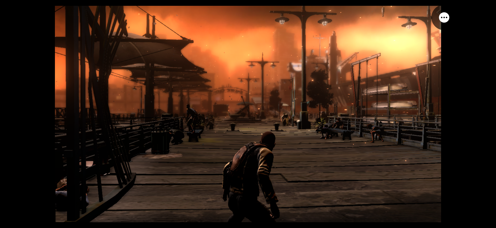
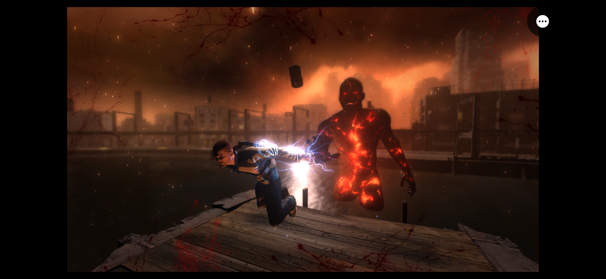
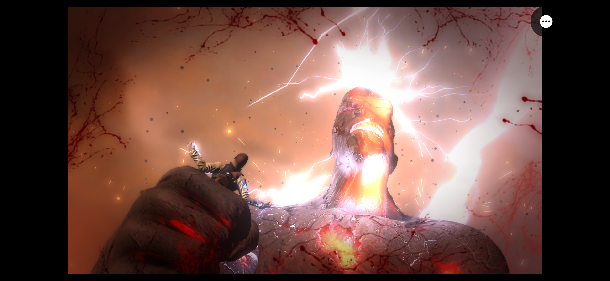
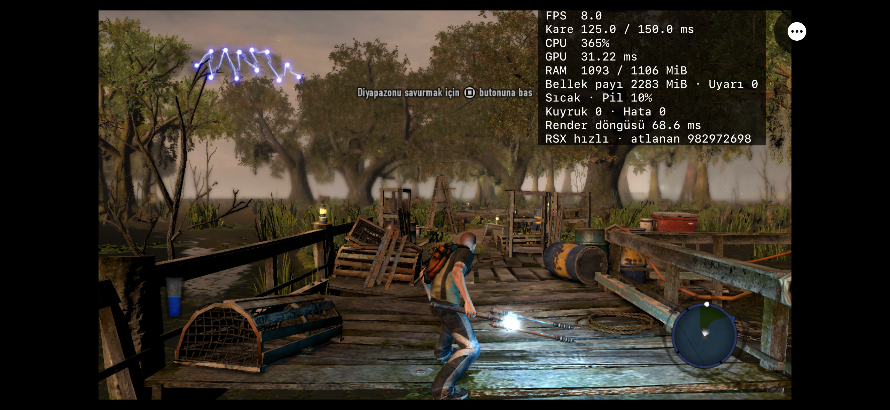

# inFAMOUS 2 — iOS

**Bringing inFAMOUS 2 to iPhone as a native, standalone iOS application.**

A development showcase by [Monsdevo](https://github.com/Monsdevo).

<em>Captured from the iPhone build — the opening waterfront scene rendered on device.</em>

---

## The project

This is an independent porting project built around the original game's code and existing PS3 static-recompilation work. The goal is to preserve the game's logic and presentation while adapting its runtime, rendering, input, and performance to iPhone hardware.

The game runs **on the iPhone itself**. A Mac is used for development and installation; gameplay does not depend on streaming, remote rendering, or a connected computer. The CPU code is statically recompiled for ARM64, with Metal used for rendering and selected compute workloads. The CPU runtime does not require JIT compilation.

**This repository is a public showcase and progress tracker. The implementation is not open source at this stage.** No source code, game data, firmware, or installable builds are published here.

## Current status

The project has moved beyond an empty Metal view: **the actual game boots and reaches controllable gameplay on a real iPhone 15 Pro.**

Confirmed so far:

- Native iOS application shell using UIKit, Objective-C++, and the existing C/C++ core.
- Metal rendering of the game menus, opening sequences, cinematics, and the first playable scene.
- Game data stored and used locally on the phone.
- Audio output and physical controller input, including DualSense testing.
- An in-game settings panel with selectable performance indicators, thermal and memory information, and CSV logging.
- Separate reference and experimental runtime paths for checking correctness and comparing performance.

This remains an **early development prototype**. Reaching the first playable scene does not mean the full campaign, every controller action, or long sessions have been validated. Touch controls are planned; they are not implemented yet.

## Screenshots

These captures show the current experimental iPhone build. Click an image to view it at full resolution.

<table>
  <tr>
    <td width="50%"></td>
    <td width="50%"></td>
  </tr>
  <tr>
    <td align="center">Opening encounter</td>
    <td align="center">Cinematic effects</td>
  </tr>
</table>

## Work completed

### From macOS to a standalone iOS app

The existing macOS recompilation project provided the starting point. Work since then has included an iOS target, an on-screen Metal surface, iOS-specific dependencies, lifecycle handling, controller/audio integration, and a device-local game-data pipeline. The macOS target remains a useful comparison platform.

Memory mapping and host-thread stack handling have also been adapted during crash diagnosis. These changes helped the project progress from boot experiments to real on-device gameplay.

### Metal lighting and SSAO

Lighting and screen-space ambient occlusion (SSAO) were identified as producers of results that the rendering path was waiting for. Their Metal paths were integrated and tested on the phone.

In separate controlled comparisons of an early gameplay scene:

| Change | Observed result |
|---|---|
| Metal lighting | Approximately **25% higher FPS** than its SPU reference |
| Metal SSAO | Approximately **27% higher FPS** than its SPU reference, with Metal lighting already enabled |

These are individual, short comparisons, not additive percentages or guarantees for the entire game. Broader visual-equivalence and stability testing is still needed.

### Profiling and optimization experiments

The project now records actual presentation timestamps, CPU samples, GPU command-buffer timings, and synchronization events. Optimization decisions are checked against frame time as well as local function costs.

ARM64 and Metal experiments have been developed for Edge geometry, skinning, and culling, with output checks against the original paths. Some local work became faster, but **a repeatable gameplay FPS improvement has not been demonstrated for those experiments**. Small GPU jobs can lose their benefit to submission and synchronization costs, so expensive candidates fall back to the CPU.

The current focus is the serial renderer path: redundant RSX state processing, vertex preparation and copying, texture-change detection, and CPU/GPU scheduling. A first change to reduce redundant legacy RSX state updates has been implemented, checked locally, and installed on the phone. **Its on-device performance comparison is pending.**

## Performance today

Recent stationary early-gameplay tests on iPhone 15 Pro were around **6 FPS** under controlled thermal conditions. Lighter scenes can run faster, but gameplay performance is still well below a comfortable target.

Performance varies with scene, temperature, and runtime settings. There is no sustained 30 FPS claim, broad device-support claim, or public release date at this point.

*Gameplay with the on-device performance overlay. HUD readings are snapshots of a particular scene and thermal condition, not an A/B benchmark or a sustained-performance claim.*

## What's next

- Validate and benchmark the latest RSX command-processing change.
- Reduce serial renderer overhead and unnecessary vertex/data conversions.
- Improve frame pacing, thermal behavior, and longer-session stability.
- Add touch controls and expand controller testing.
- Adapt the camera/projection to wider iPhone aspect ratios without stretching the image.
- Expand save/load, visual-correctness, and gameplay testing beyond the opening area.

## Follow the development

This repository will document milestones and development progress. Questions and feedback are welcome through [Issues](https://github.com/Monsdevo/infamous2-ios/issues).

inFAMOUS 2 is a Sucker Punch Productions / Sony Computer Entertainment title. This is an unofficial project and is not affiliated with or endorsed by its creators.
