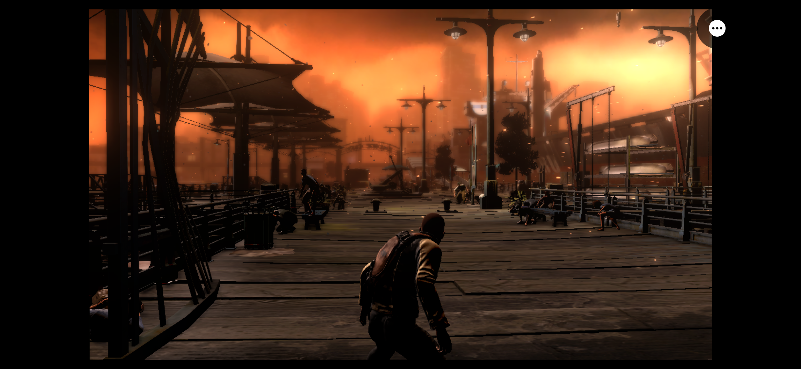
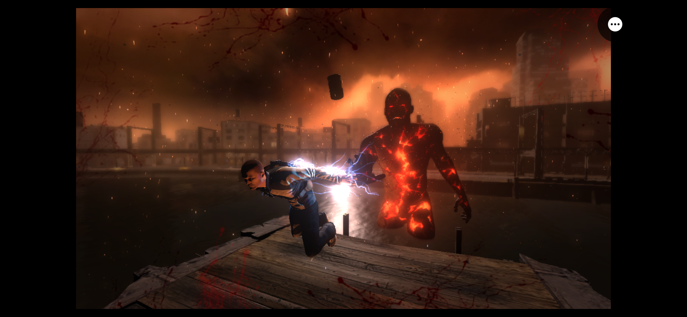
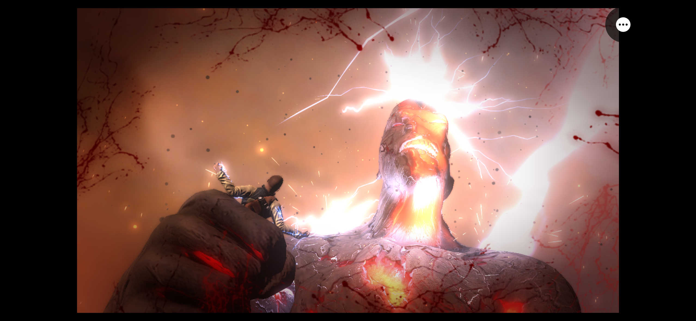
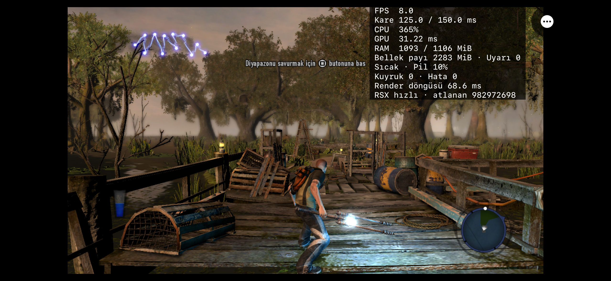

# inFAMOUS 2 — iOS

**Bringing inFAMOUS 2 to iPhone as a native, standalone iOS application.**

A development showcase by [Monsdevo](https://github.com/Monsdevo).

<em>Captured from the iPhone build — the opening waterfront scene rendered on device.</em>

---

## The project

This is an independent porting project built around the original game's code and existing PS3 static-recompilation work. The goal is to preserve the game's logic and presentation while adapting its runtime, rendering, input, and performance to iPhone hardware.

The game runs **on the iPhone itself**. A Mac is used for development and installation; gameplay does not depend on streaming, remote rendering, or a connected computer. The CPU code is statically recompiled for ARM64, with Metal used for rendering and selected compute workloads. The CPU runtime does not require JIT compilation.

**This repository is a public showcase and progress tracker. The implementation is not open source at this stage.** No source code, game data, firmware, or installable builds are published here.

## Current status

**Updated November 7, 2026 · Latest device build: 67**

The project has moved beyond an empty Metal view: **the actual game boots and reaches controllable gameplay on a real iPhone 15 Pro.**

Confirmed so far:

- Native iOS application shell using UIKit, Objective-C++, and the existing C/C++ core.
- Metal rendering of the game menus, opening sequences, cinematics, and the first playable scene.
- Game data stored and used locally on the phone.
- Audio output and physical controller input, including DualSense testing.
- An English-language in-game settings panel with selectable performance indicators, thermal and memory information, and CSV logging.
- Separate reference and experimental runtime paths for checking correctness and comparing performance.
- On-device testing in the opening waterfront area and a saved swamp scene.

This remains an **early development prototype**. Reaching the first playable scene does not mean the full campaign, every controller action, or long sessions have been validated. Touch controls are planned; they are not implemented yet.

## Screenshots

These captures show earlier development builds running on iPhone. They document rendering progress rather than the latest performance figures. Click an image to view it at full resolution.

<table>
  <tr>
    <td width="50%"></td>
    <td width="50%"></td>
  </tr>
  <tr>
    <td align="center">Opening encounter</td>
    <td align="center">Cinematic effects</td>
  </tr>
</table>

## Work completed

### From macOS to a standalone iOS app

The existing macOS recompilation project provided the starting point. Work since then has included an iOS target, an on-screen Metal surface, iOS-specific dependencies, lifecycle handling, controller/audio integration, and a device-local game-data pipeline. The macOS target remains a useful comparison platform.

Memory mapping and host-thread stack handling have also been adapted during crash diagnosis. These changes helped the project progress from boot experiments to real on-device gameplay.

### Optimizations with measured gains

Lighting and screen-space ambient occlusion (SSAO) were identified as producers of results that the renderer was waiting for. Their compute paths were moved to Metal while retaining the original statically recompiled SPU paths for reference and fallback.

| Change | Observed iPhone 15 Pro result | Scope |
|---|---|---|
| Metal lighting | **3.97 → 4.97 FPS**, approximately **25% higher FPS** | Early stationary-gameplay A/B pilot; roughly 50 ms less per frame |
| Metal SSAO | **4.84 → 6.16 FPS**, approximately **27% higher FPS** and **44 ms saved per frame** | Separate pilot with Metal lighting already enabled |
| Far-light rejection | Approximately **3.8–5.1% higher FPS**, **5.7–8.1 ms saved per frame** | Two controlled comparison sequences on a warmed phone |
| Combined light-mask and runtime improvements | **6.30 → 6.99 FPS**, approximately **10.9% higher FPS** and **15.6 ms saved per frame** | Cooled opening-scene A/B/A; Metal lighting and SSAO enabled in both configurations |

The combined profile includes far-light rejection, conservative interval-based light-tile masks, and faster SPU dispatch / stack-reset checks. Its result measures the **package**, not the independent contribution of each component. Far-light rejection is already included in that package. These percentages and millisecond savings must not be added together.

Lighting tile-mask alpha handling was also corrected. SSAO boundary cleanup prevents remaining reference depth work from reclaiming AO tiles already handled by Metal. That cleanup removed observed duplicate work, but its small FPS difference was not independently established as a repeatable gain.

The working baseline uses O2-compiled SPU code, adapted guest-memory mapping and host-thread stacks, and the verified combined paths. Memory and stack changes helped resolve diagnosed allocation failures; they are stability work, not measured FPS gains. The O2 build also remains in use, without claiming a clean isolated O1/O2 speedup from the earlier crash-affected comparison.

### What we tried without an accepted FPS gain

Renderer, SPU, and DMA experiments have been tested on Mac and iPhone. Several reduced work in a specific stage while leaving the overall frame interval effectively unchanged.

| Experiment | Tested on | Result |
|---|---|---|
| Edge geometry, skinning, and culling through ARM64 and Metal alternatives | iPhone | No repeatable gameplay FPS gain. Early fine-grained GPU versions were substantially slower; reworked versions added batching, sparse data transfer, and cost-based fallback, but still did not establish a gain. |
| Skipping redundant legacy RSX state updates | iPhone | Reduced repeated state processing, but no meaningful end-to-end FPS improvement was demonstrated. This is not counted as a verified speedup. |
| Vertex-decode and texture-hash caches | iPhone | High cache-hit rates did not produce a repeatable frame-time gain. Experimental caches remain disabled. |
| Depth-only rendering variants and wider SPU arithmetic / register-localization experiments | Mac | No accepted repeatable gain after controls and measurement overhead were accounted for. Mac results are not presented as iPhone gains. |
| Omitting the normal-buffer writeback to guest memory | Mac | A reference SPU fallback still needed the omitted input. The safety guard stopped the experiment; there is no valid optimized FPS result and it was not enabled on iPhone. |
| Indirect SPU branch-address cache | Mac | High hit coverage, but no repeatable FPS improvement. Not promoted to the iPhone baseline. |
| Skipping the DMA payload diagnostic scan | iPhone | No repeatable gain; the original scan remains enabled. DMA copies, fences, and coherence rules were preserved. |
| Last-matching MFC slot hint | iPhone | The apparent approximately 1% aggregate difference was driven mainly by a later reference slowdown. No repeatable gain accepted. |
| Overlay signature / page rejection filter | iPhone | Approximately **10.04 vs. 10.02 FPS** for reference vs. candidate; no meaningful gain. |
| Inlining frequent MFC channel accesses | iPhone | Approximately **8.83 vs. 8.73 FPS**; no meaningful gain. |
| Aligning MFC registry slots to 128 bytes | iPhone | Approximately **8.96 vs. 8.74 FPS**; no meaningful gain. The original slot layout was restored. |
| Compact vertex transfer (build 64) | iPhone | Vertex preparation CPU time fell from **21.22 to 16.93 ms** in short traces. In a separate A/B/A test, the mean frame interval was **0.41 ms** lower than the average of the two references and the median held steady. |
| Reusing the depth synchronization point for the normal buffer (build 67) | iPhone | One fewer Metal submission per frame in the sampled traces and about **1 ms less median synchronous wait**. With the experiment enabled, the test averaged **9.42 FPS** between **9.30** and **9.20 FPS** references. The frame-time median held steady and the experiment remains off by default. |

These outcomes describe the implementations and scenes tested. They do not prove that geometry, caching, or DMA can never be optimized. Small positive or negative differences are not treated as causal speedups or regressions when the reference itself drifts. Unproven geometry, cache, and DMA alternatives are kept out of the normal optimized profile.

### What the renderer traces revealed

The first full-resolution depth readback blocks the RSX renderer thread for **14–17 ms** in the sampled iPhone frames. Most of that interval overlaps GPU execution. The depth copy itself accounts for roughly **1.6–1.8 ms**. Removing the first wait would help only to the extent that CPU work can overlap that GPU execution. Build 67 removed the later normal-buffer wait while preserving both guest-memory copies.

The first observed reader of the full-resolution depth was the original SPU depth stage of SSAO, even with Metal SSAO enabled. On-device comparisons of the 640×360 SPU and Metal outputs found differences of at most two units in the last place (ULPs) in the sampled frames. Short traces found no readers of the guest half-resolution copy at the instrumented points. Coverage is limited to the sampled scenes and access paths, so the original depth stage remains in place.

### How comparisons are checked

Measurements use actual on-device presentation timestamps, with CPU sampling and synchronization traces collected separately. FPS windows exclude output validation, screenshots, active profilers, and new shader compilation. Tests check the selected path's actual execution, application state, thermal category, and rendering errors.

Where practical, reference and candidate runs are bracketed by a return to the reference. Layout changes require fresh processes rather than live switching. Recent tests also use natural, uncooled operation instead of requiring external cooling. A fixed thermal category does not guarantee identical chip clocks, so reference drift is reported rather than hidden.

## Performance today

**Build 67 averaged about 9.25 FPS in the saved swamp scene on iPhone 15 Pro with the new experiment disabled. The earlier opening waterfront benchmark averaged about 7 FPS.** Both figures describe stationary scenes. A full-game average is still unknown.

| Reference scene | Average FPS | Mean frame interval | Conditions |
|---|---:|---:|---|
| Opening waterfront, verified combined profile | **6.99** | **143.0 ms** | Stationary, externally cooled, nominal thermal category; October 31 |
| Saved swamp / wooden walkway, build 67 reference | **9.25** | **108.1 ms** | Stationary, naturally warmed phone, serious thermal category; November 7 |

The latest swamp result pools the two reference windows that bracketed the fence experiment. They individually measured **9.30 and 9.20 FPS**. The waterfront benchmark uses a different scene and thermal condition. Sustained 30 FPS remains a goal.

*Previously captured iPhone gameplay with the performance overlay. This screenshot predates the latest measurements; its HUD reading is not the current benchmark average.*

The full campaign, long-session stability, and complete visual equivalence remain unvalidated. There is no public release date or broad device-support claim.

## What's next

- Prototype a Metal path that avoids the first synchronous depth readback while preserving the original SPU fallback and completion signals.
- Check whether the change reduces the interval between presented frames or moves the wait to a later synchronization point. Validate across additional scenes before considering it for the default profile.
- Improve frame pacing, sustained thermal behavior, and longer-session stability.
- Add touch controls and expand controller testing.
- Adapt the camera/projection to wider iPhone aspect ratios without stretching the image.
- Expand save/load, visual-correctness, and gameplay testing beyond the areas tested so far.

## Follow the development

This repository will document milestones and development progress. Questions and feedback are welcome through [Issues](https://github.com/Monsdevo/infamous2-ios/issues).

inFAMOUS 2 is a Sucker Punch Productions / Sony Computer Entertainment title. This is an unofficial project and is not affiliated with or endorsed by its creators.
